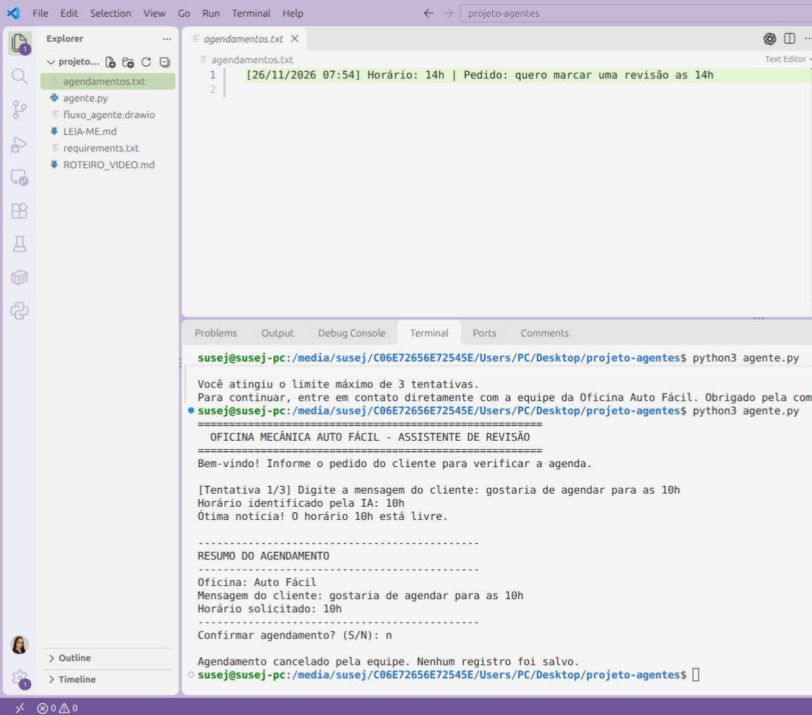
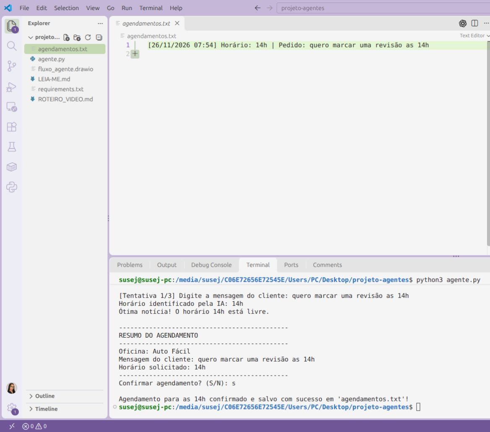
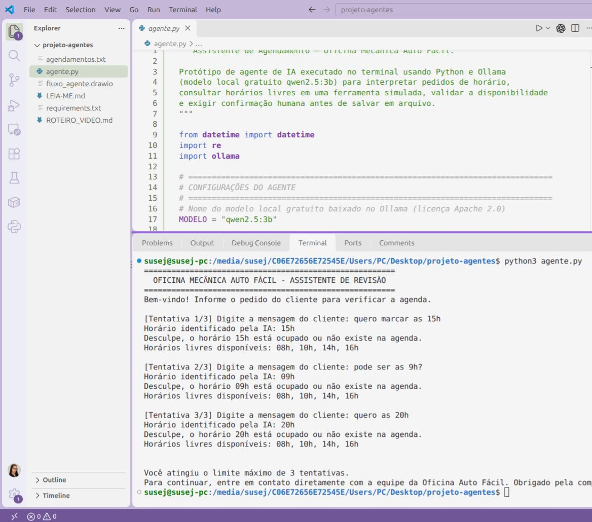
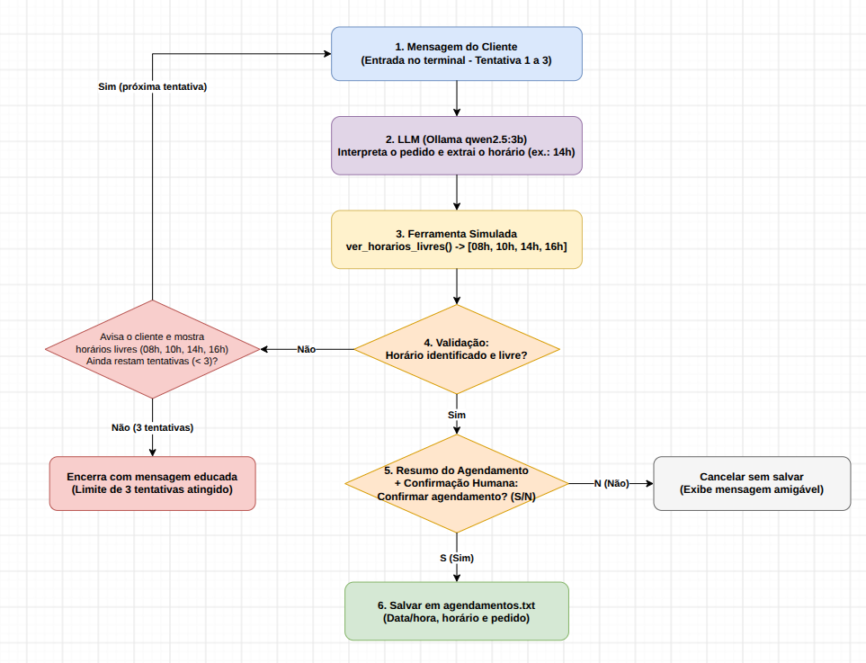

# Assistente de Agendamento — Oficina Mecânica Auto Fácil

Protótipo de agente de IA simples em Python para auxiliar o atendimento da **Oficina Mecânica Auto Fácil**. O sistema interpreta pedidos de revisão no terminal usando um modelo local gratuito (**Ollama + `qwen2.5:3b`**), consulta horários livres em uma ferramenta simulada e exige **confirmação humana (`S/N`)** antes de registrar o agendamento em `agendamentos.txt`.

---
## Enlace do video: https://drive.google.com/file/d/1SJ8BBS3ah5ummCPAPy0tzN1q222zvz2k/view?usp=sharing

## capturas:
1. Cancelada:


2. Agendamento confirmado

3. Tentativas


## 1. Como instalar e executar

### Pré-requisitos (ferramentas gratuitas e livres)
- **Python 3** (3.10 ou superior) e editor **Thonny** ou **VSCodium**
- **Ollama** instalado no computador

### Passo a passo
1. Baixe o modelo gratuito de IA no terminal (licença Apache 2.0):
   ```bash
   ollama pull qwen2.5:3b
   ```
2. Instale a biblioteca oficial do Ollama para Python:
   ```bash
   pip install ollama
   ```
   *(Ou `pip install -r requirements.txt`)*
3. Execute o agente na pasta do projeto:
   ```bash
   python3 agente.py
   ```
   *(Também é possível abrir `agente.py` no **Thonny** e clicar em **Executar**.)*

---

## 2. Fluxo do agente

> *(O arquivo editável [`fluxo_agente.drawio`](fluxo_agente.drawio) pode ser aberto no draw.io / diagrams.net para exportar a imagem ao gerar o documento no LibreOffice Writer.)*



---

## 3. Três limites do agente

1. **Agenda fixa e sem controle de datas:** A função `ver_horarios_livres()` retorna sempre a mesma lista em memória (`08h`, `10h`, `14h`, `16h`). O agente não diferencia dias da semana nem remove um horário da lista depois que ele é salvo.
2. **Limitações de interpretação do modelo pequeno (`qwen2.5:3b`):** Por ser um modelo leve de 3 bilhões de parâmetros, mensagens muito ambíguas, com erros graves de digitação ou contendo mais de um horário na mesma frase podem gerar extrações imprecisas.
3. **Sem dados completos do cliente e sem integração externa:** O protótipo registra apenas data/hora do sistema, horário escolhido e texto do pedido no arquivo local `agendamentos.txt`; ele não coleta nome, telefone ou placa do veículo e não se conecta a WhatsApp, banco de dados ou calendário real.
